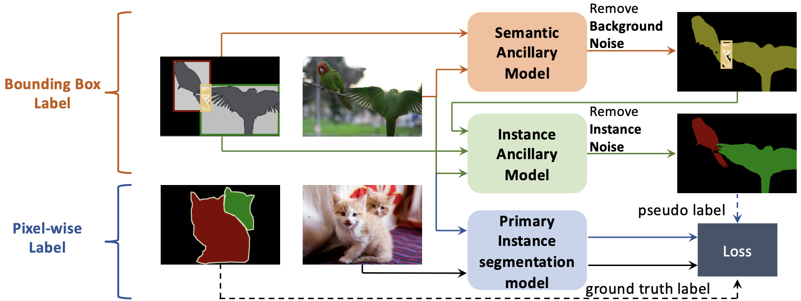

# Hybrid Supervised Instance Segmentation by Learning Label Noise Suppression

> Linwei Chen, Ying Fu*, Shaodi You and Hongzhe Liu
>
> **Paper**: [*Hybrid Supervised Instance Segmentation by Learning Label Noise Suppression*](https://www.sciencedirect.com/science/article/pii/S0925231222005574), Neurocomputing 496:131-146, 2022.

Official implementation on **PASCAL VOC 2012** and **Cityscapes**. This repo releases the complete training/evaluation code of our hybrid (weak + semi + full) supervised instance segmentation framework, together with the **verbatim evaluation logs of every experiment in the paper**, so that each table entry can be traced to its original record.

This is the journal extension of our Remote Sensing 2021 paper on aerial images ([Efficient Hybrid Supervision for Instance Segmentation in Aerial Images](https://github.com/Linwei-Chen/Efficient-Hybrid-Supervision-for-Instance-Segmentation-in-Aerial-Images)); the semantic branch code (`SpatialEmbeddings/`) is shared between the two repos.

**Abstract**

Current fully supervised instance segmentation methods severely rely on the large amounts of pixel-wise annotations that are usually expensive and time-consuming to obtain. Though weakly or semi-supervised methods utilize cheap bounding box labeled, image-level labeled or unlabeled samples to save the labeling cost, their performance is largely sacrificed. To save labeling cost without losing much performance, in this paper, we present a pipeline which can utilize economical bounding box labels and clear pixel-wise labels in a hybrid way. Specifically, we design two ancillary models to learn label noise suppression and obtain accurate pseudo pixel-wise labels from bounding box labels for training. One is designed to suppress mislabeling between foreground and background, and the other is designed to suppress noise from mislabeling of instances. Moreover, we exploit category-aware spatial attention module, category constraint module, instance constraint module, and self-learning training approach to improve the accuracy of pseudo labels. Experiments on PASCAL VOC 2012 and Cityscapes datasets show that our method can achieve competitive performance with much less labeling cost.



## A note on model weights

Before this release we re-evaluated **every checkpoint preserved in our archive** against the paper's own protocols. All detector checkpoints found in the archive predate the paper versions — the final weights were rotated out after the paper's evaluation (the same pattern across our VOC / Cityscapes / iSAID projects) — and score below the published numbers. Following our release policy (*only release artifacts that match or exceed the paper*), **no detector weights are included**. Instead, every experiment's verbatim evaluation log is shipped under `results/`, fully specifying how each reported number was produced.

## Framework

The framework trains a Mask R-CNN detector with three label sources:

1. a small set of **pixel-wise masks** (1%–20% of the data),
2. **bounding-box** annotations on the rest of the data,
3. **pseudo masks** produced by two ancillary models that learn label-noise suppression: a semantic segmentation model (DeepLab-v3+, `FCN-Pytorch/`) suppressing foreground/background mislabeling, and an instance-discrimination branch (`SpatialEmbeddings/`) suppressing instance-level mislabeling — refined by category-aware spatial attention, category/instance constraints, and self-learning.

## Repository layout

```
VOC/                          # PASCAL VOC 2012 experiments (Table 3): 1%~20% ratios, bbox+seg mixes, baselines
VOC-Semi/                     # VOC semi-supervised variants
Cityscapes/                   # Cityscapes experiments (Table 4): 1%~20% ratios, fully, weakly, only-bbox
Cityscapes-Semi/              # Cityscapes semi-supervised variants (incl. balanced/unbalanced loss mixes)
R-101-22k-VOC-Weakly-fix_lr/  # weakly-supervised VOC baseline (ResNet-101, 22k iters)
FCN-Pytorch/                  # ancillary model 1: DeepLab-v3+ semantic segmentation (train/eval/self-learning)
SpatialEmbeddings/            # ancillary model 2: instance-discrimination semantic branch + pseudo-mask generation
results/                      # verbatim result.txt of every experiment — the paper numbers' source
eval_iou70.py                 # reproduces the paper's mAPr@0.5/0.7/0.75 protocol from a COCOEvaluator output
```

Each experiment directory contains its own `detectron2_test.py` (training/evaluation launch script) and, where applicable, `eval.py` (dataset-specific evaluator wrapper). Nested sub-directories are historical iterations kept as-is.

## Environment (historical, as verified in 2026)

- Python 3.6 / PyTorch 1.10.1 + CUDA 11.3
- detectron2 **v0.6** (build from source; the code was originally developed on a 2020-era fork)
- opencv 4.3.0.38, shapely 1.7.1, pycocotools, cityscapesscripts 2.3.0

```bash
pip install -r requirements.txt
# detectron2 v0.6:
python -m pip install 'git+https://github.com/facebookresearch/detectron2.git@v0.6'
```

## Data preparation

**PASCAL VOC 2012 + SBD** (Table 3): standard `VOCdevkit/VOC2012` plus `SegmentationClassAug` (SBD-augmented masks). The experiment scripts consume pre-converted COCO-style json annotations via `register_coco_instances`.

**Cityscapes** (Table 4): `leftImg8bit/` + `gtFine/` val split (500 images). The scripts evaluate with the **official `cityscapesscripts` instance evaluation** via `CityscapesInstanceEvaluator`.

Datasets are governed by their own licenses and are **not** redistributed — please download them from the official sources.

## Evaluation protocols (important — the two tables use different protocols)

- **VOC (Table 3)** — `mAPr@0.5 / 0.7 / 0.75` are **COCO-style segmentation AP at IoU = 0.5 / 0.7 / 0.75**, produced by `COCOEvaluator`. The paper-era environment carried a locally patched pycocotools that printed AP@0.70 in the AP50 summary slot; `eval_iou70.py` reproduces exactly those three numbers from a stock evaluation output (`coco_instances_results.json`).
- **Cityscapes (Table 4)** — `AP / AP50` follow the **official Cityscapes instance-segmentation protocol** (`cityscapesscripts`), test resolution 1024×2048 (`MIN_SIZE_TEST=1024`, `MAX_SIZE_TEST=2048`).

## Reproducing the paper numbers

Every experiment directory in `results/` is the verbatim evaluation log of a paper row:

- `results/VOC/eval_105/result.txt` ↔ Table 3 row "105 (1%)": segm AP@0.5/0.7/0.75 = **61.8 / 42.7 / 35.2**
- `results/Cityscapes/results_0.01/result.txt` ↔ Table 4 row "Ours 1%": AP/AP50 = **19.4 / 40.2**

To re-evaluate a trained model, run its experiment's `detectron2_test.py` (or `eval.py`), then apply `eval_iou70.py` for the VOC protocol.

## Citation

If you use our code for research, please ensure that you cite our paper:

```bibtex
@article{chen2022hybrid,
    title={Hybrid supervised instance segmentation by learning label noise suppression},
    author={Chen, Linwei and Fu, Ying and You, Shaodi and Liu, Hongzhe},
    journal={Neurocomputing},
    volume={496},
    pages={131--146},
    year={2022},
    publisher={Elsevier}
}
```

## Questions

If you have any questions, please email to chenlinwei@bit.edu.cn.

## License

Released for academic research use. PASCAL VOC, SBD, and Cityscapes are governed by their own licenses; annotations are **not** redistributed.
